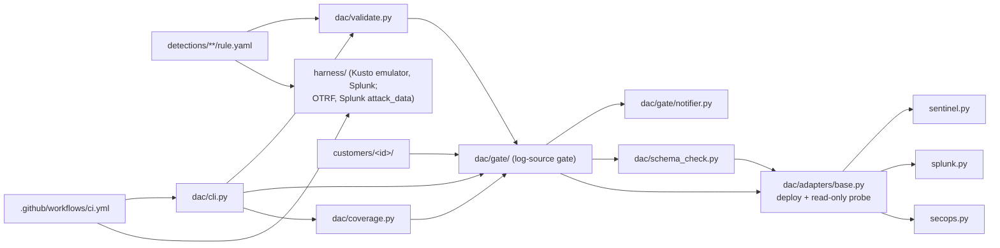

# CLAUDE.md

## Project

Detection-as-code portfolio project: up to 10 detection rules, each
documented as an attack and as a detection, deployed through one
pipeline to Microsoft Sentinel (KQL), Splunk (SPL) and Google SecOps
(YARA-L), per customer (MSSP-style). Before deploying, a schema check
probes each customer's SIEM for the tables and fields a rule reads,
and a gate holds back rules whose data is not confirmed. Coverage is
reported per customer as ATT&CK / ATLAS Navigator layers. No live SIEM
exists; everything except API credentials is built and tested here.

Time-boxed (about 3 weeks from 2026-10-27), not a platform. Before
adding a rule, SIEM, data source or feature beyond the Scope below,
check the request is explicit from the owner (Venu).

## Scope

| # | Track | Rule | Mapping | Targets |
|---|-------|------|---------|---------|
| A1 | endpoint | Encoded / download-cradle PowerShell | T1059.001 | Sentinel, Splunk, SecOps |
| A2 | endpoint | Run-key persistence by a non-installer process | T1547.001 | Sentinel, Splunk, SecOps |
| A3 | endpoint | SAM/SYSTEM hive dump | T1003.002 | Sentinel, Splunk, SecOps |
| A4 | endpoint | LOLBin download (certutil, bitsadmin, curl) | T1105 | Sentinel, Splunk, SecOps |
| B1 | identity | Illicit OAuth consent grant | T1528 | Sentinel |
| B2 | identity | Risky permission or credential added to an app | T1098.001 | Sentinel |
| B3 | identity | Sign-in pattern consistent with token replay | T1550.001 (+ T1550.004, 2026-10-27) | Sentinel |
| C1 | llm | Prompt-injection patterns | OWASP LLM01 (2025) + ATLAS | Sentinel |
| C2 | llm | Canary secret in model output | OWASP LLM02 (2025) + ATLAS | Sentinel |
| C3 | llm | Abnormal tool-call volume | OWASP LLM06/LLM10 (2025) + ATLAS | Sentinel |

Built: A1-A4 (2026-10-27), `status: test`, A1/A3/A4 baseline, A2
targeted. KQL and SPL run in local engines on recorded OTRF data
(ADR 007); YARA-L not run anywhere. B1-B3 built (2026-10-27),
`status: test`, Sentinel only, KQL run in the Kusto emulator on recorded
Entra logs (Splunk attack_data, OTRF); B1/B2 baseline, B3 targeted
(false-positive profile unmeasured; no recorded sign-in has a
SessionId, so B3's positives are hand-written). C1-C3 not built.
Common high-value rules outside this list (brute force, AD changes)
are parked in BUILD_LOG.md for the owner, not in scope. ATT&CK IDs above were checked against the enterprise
STIX bundle on 2026-10-27 (all exist, none deprecated). ATLAS IDs are
not yet fetched. No OWASP LLM Top 10 2026 list has been confirmed to
exist; rules use 2025 IDs.

Cut order if behind: Sigma (not started) → C3 → B3. Docs, negative
tests and evidence are never cut.

## Architecture

Hand-authored; update by hand when the pipeline changes.

- `detections/<endpoint|identity|llm>/<#>-<ATT&CK ID>-<name>/` (e.g.
  `A1-T1059.001-encoded-powershell`) - one folder per rule: `rule.yaml`,
  `README.md` (rule doc), `attack.md` (attack doc),
  `tests/positive.json`, `tests/negative.json`, `tests/evidence.md`,
  `tests/datasets.yaml`, `tests/results/<engine>.json`.
- `schemas/rule.schema.json` - the rule format (ADR 001), incl. `tier`
  and per-SIEM `required_fields`.
- `schemas/reference/<siem>/` - vendor-documented table schemas with
  provenance (Sentinel SecurityEvent, Event, Syslog, CommonSecurityLog;
  AuditLogs, SigninLogs, AADNonInteractiveUserSignInLogs with column
  types from Microsoft's Azure-Sentinel repo).
- `log_sources.yaml` - log-source catalogue: owning team key and
  per-SIEM table / source / log type names.
- `customers/<id>/` - `customer.yaml` (SIEMs, include/exclude),
  `teams.yaml`, `confirmations/<siem>/`, `schemas/<siem>/` (ADR 004).
  One fictional customer, `demo`. No confirmations yet.
- `dac/validate.py` - offline checks (docs/components/validation.md).
- `dac/adapters/` - one `SiemAdapter` interface, three adapters
  (ADR 002, docs/components/adapters.md).
- `dac/schema_check.py` - required fields vs. probe / customer schema
  (ADR 005, docs/components/schema-check.md).
- `dac/gate/` - per-customer log-source gate and notifiers
  (docs/components/log-source-gate.md).
- `dac/coverage.py` - Navigator layers + summary per customer
  (ADR 006, docs/components/coverage.md).
- `dac/cli.py` - `python -m dac validate | customers | schema-check |
  gate | plan | deploy | coverage`.
- `.github/workflows/ci.yml` - validate on every push/PR; per customer
  x SIEM: schema check + report-only gate on PRs, gated deploy on
  `main`; coverage per customer on `main`. One GitHub Environment per
  customer holds its secrets (docs/components/ci.md).
- `harness/` - engine tests (ADR 007, docs/components/engine-tests.md):
  `datasets.yaml` (pinned OTRF and Splunk attack_data datasets),
  `mapping.py` (recorded event -> SecurityEvent / Event / XmlWinEventLog;
  Entra diagnostic records -> AuditLogs / SigninLogs /
  AADNonInteractiveUserSignInLogs), `engines.py` (Kusto
  emulator, Splunk container), `python -m harness fetch | run`.
- `docs/future/` - design-only notes, unbuilt and not scheduled (RAG
  over the attack docs).
- `templates/` - attack-doc and rule-doc templates; their `##`
  headings are the ones the validator requires.
- `tests/` - pytest; `tests/fixtures/rules/` holds one pipeline
  fixture rule (not a reviewed detection), `tests/fixtures/api/` holds
  API responses written from vendor docs (not recorded).
- `.claude/skills/` - `build-and-document`, `new-detection`,
  `log-source-gate`, `schema-check`, `coverage-map` (docs/skills.md).

## Conventions

- Every rule ships with its attack doc, rule doc, positive and negative
  samples and evidence in the same PR. CI rejects a missing or
  placeholder section.
- Samples are labelled recorded (with dataset and file) or
  hand-written. Hand-written samples are never presented as attack
  data.
- `evidence.md` records an actual engine run (engine, date, counts),
  from `python -m harness run --write`. If a SIEM's query was not run
  (YARA-L today), it says so. Emulated engines are named as emulated.
- Recorded datasets only with a licence that allows reuse, pinned by
  commit and SHA-256 in `harness/datasets.yaml`.
- Citations come from fetched primary sources with the fetch date.
  Never cite from memory, never invent campaign details or IDs.
- A check is described by exactly what it tests. List what it misses;
  never say it "closes" a problem.
- Live-API behavior (deploy and probe) is "not verified" until a live
  call is made and logged in BUILD_LOG.md.
- Reference schemas only from fetched vendor sources, with provenance.
  Customer schema files only from what the customer sent.
- Coverage counts only rules that passed the gate. Never present a
  coverage map without its caveats.
- Secrets only via environment variables / GitHub Actions secrets.
- ADRs and BUILD_LOG.md are append-only; correct with dated amendments.

## Testing

`python -m pytest` from the repo root before every commit, plus
`yamllint .`. CI also runs `python -m dac validate` against the
current MITRE ATT&CK bundle.

- `test_validate.py` - schema, sources, query checks, docs, ATT&CK.
- `test_adapters.py` - query checks and requests per SIEM; deploy
  against a fake transport.
- `test_gate.py` - per-customer gate: confirmations, probe
  auto-confirm and veto, tiers, reminders, notifier choice.
- `test_schema_check.py` - required fields vs. probe / customer schema.
- `test_coverage.py` - active vs. blocked, layers, summary.
- `test_cli.py` - commands end to end on the fixture rule and customer.
- `test_harness.py` - harness mapping, result checks, dataset fetch
  (offline; the engine runs are `python -m harness run`).
- Probe tests live in `test_adapters.py`.
- Engine tests: `python -m harness run --engine kusto` (also CI job
  `engine-kusto`) and `--engine splunk` (local only).

Last run (2026-10-27): 127 passed, 0 failed; engine tests: A1-A4 pass
in Kusto emulator and Splunk 10.6.1, B1-B3 in the Kusto emulator.

## Model usage

Same convention as attackKnowledgeGraph: Haiku for mechanical runs and
formatting, Sonnet for implementation and drafting from sources in
hand, Opus for judgment calls where a subtle error becomes wrong data
(detection logic trade-offs, ATT&CK/OWASP mapping disputes, reconciling
conflicting sources).

## Current status

- Built: rule schema, validator, three adapters with read-only probes,
  schema check, per-customer log-source gate with file and SMTP
  notifiers, baseline/targeted tiers, coverage layers, CLI, CI
  workflow, engine harness, component docs, ADRs 001-007, templates,
  five skills; rules A1-A4, B1-B3.
- Verified: everything in the test suite; ATT&CK IDs for the planned
  rules against the STIX bundle; the first CI workflow ran green on
  GitHub (PR #1); per-customer gate job ran green (PR #2); A1-A4 KQL in
  the Kusto emulator and SPL in Splunk 10.6.1 on 45,370 recorded OTRF
  events (only attack events matched); B1-B2 KQL on recorded Entra
  audit logs (only attack or lab-test events matched).
- Not verified: any live API call (Sentinel, Splunk, SecOps deploy or
  probe, SMTP); Navigator loading of the layers (ATLAS `domain` value
  is a guess); the deploy and coverage CI jobs on `main`; A1-A4 in a
  real Log Analytics workspace or with the Splunk Windows add-on; any
  YARA-L rule; production false-positive rates. SecurityEvent and
  Event reference schemas came through a summarising fetch tool. B3
  against any recorded sign-in with a SessionId (none available); B2's
  app-permission branch against a recorded event.
- Next: LLM rules C1-C3 (needs the gateway log format decided and ATLAS
  IDs fetched).

## Do NOT

- Don't add rules, SIEMs or features beyond Scope without the owner's
  explicit go-ahead. Park ideas in BUILD_LOG.md.
- Don't commit a log-source confirmation the owning team did not give.
- Don't describe the dry-run pipeline as deploying to real SIEMs.
- Don't add real API keys, tenant names or customer data.
