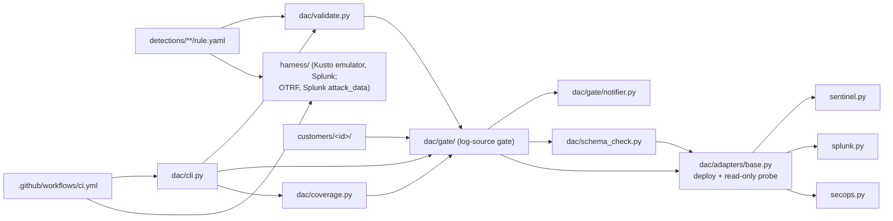

# CLAUDE.md

## Project

Detection-as-code portfolio project: up to 10 detection rules, each
documented as an attack and as a detection, deployed through one
pipeline to Microsoft Sentinel (KQL), Splunk (SPL) and Google SecOps
(YARA-L), per customer (MSSP-style). Before deploying, a schema check
probes each customer's SIEM for the tables and fields a rule reads,
and a gate holds back rules whose data is not confirmed. Coverage is
reported per customer as ATT&CK / ATLAS Navigator layers. No live SIEM
exists; everything except API credentials is built and tested here.

Time-boxed (about 3 weeks from 2026-10-27), not a platform. Before
adding a rule, SIEM, data source or feature beyond the Scope below,
check the request is explicit from the owner (Venu).

## Scope

| # | Track | Rule | Mapping | Targets |
|---|-------|------|---------|---------|
| A1 | endpoint | Encoded / download-cradle PowerShell | T1059.001 | Sentinel, Splunk, SecOps |
| A2 | endpoint | Run-key persistence by a non-installer process | T1547.001 | Sentinel, Splunk, SecOps |
| A3 | endpoint | SAM/SYSTEM hive dump | T1003.002 | Sentinel, Splunk, SecOps |
| A4 | endpoint | LOLBin download (certutil, bitsadmin, curl) | T1105 | Sentinel, Splunk, SecOps |
| B1 | identity | Illicit OAuth consent grant | T1528 | Sentinel |
| B2 | identity | Risky permission or credential added to an app | T1098.001 | Sentinel |
| B3 | identity | Sign-in pattern consistent with token replay | T1550.001 (+ T1550.004, 2026-10-27) | Sentinel |
| B4 | identity | Honeytoken app credential or decoy Key Vault object used (2026-11-07) | T1078.004, T1555.006 | Sentinel |
| B5 | identity | One SP credential from Microsoft's network and outside it (2026-11-07) | T1078.004 | Sentinel |
| B6 | identity | SP sign-in from an ASN new in 14 days (2026-11-07) | T1078.004 | Sentinel |
| B7 | identity | SP Graph calls unlike its app: new client, enumeration, fix-and-retry (2026-11-07) | T1087.004, T1069.003, T1526 | Sentinel |
| D1 | recon | Request to a decoy API route; the path is a `Honeytoken_CL` row (2026-11-07) | T1595, T1594 | Sentinel |
| D2 | recon | Source map / Swagger / config download, then API routes the UI does not call (2026-11-07) | T1594, T1595 | Sentinel |
| D3 | recon | One client, dozens of distinct paths in minutes, mostly 401/403/404 (2026-11-07) | T1595.003 | Sentinel |
| D4 | recon | AccessDenied / UnauthorizedOperation burst across AWS services from one principal (2026-11-07) | T1580 | Sentinel |
| E1 | foothold | One client reads 20+ record IDs in 10 minutes: in order, denials mixed with 200s, or volume above baseline (2026-11-07) | T1190 | Sentinel |
| E2-E4 | foothold | Web server or database process starts a shell or download tool: Defender for Endpoint, Windows Sysmon, Sysmon for Linux (2026-11-07) | T1505.003, T1059 (E4 T1059.004) | Sentinel |
| E5-E6 | foothold | New .jsp/.aspx/.php file in a web root, High when written by a database process: Defender for Endpoint, Windows Sysmon (2026-11-07) | T1505.003 | Sentinel |
| E8 | foothold | App Service publishing login (Kudu, FTP, Web Deploy) by a non-pipeline identity (2026-11-07) | T1078.004 | Sentinel |
| E9 | foothold | Server connects to a request-capture service (webhook.site, interactsh) (2026-11-07) | T1567.004 | Sentinel |
| C1 | llm | Prompt-injection patterns | OWASP LLM01 (2025), LLM01:2026; ATLAS AML.T0051.000/.001, T0054, T0056, T0068 | Sentinel |
| C2 | llm | Canary secret in model output | OWASP LLM02 (2025) (+ LLM07, 2026-10-27), LLM02/LLM08:2026; ATLAS AML.T0056, T0057, T0086 | Sentinel |
| C3 | llm | Abnormal tool-call volume | OWASP LLM06/LLM10 (2025), LLM03/LLM06:2026; ATLAS AML.T0053, T0034.002 | Sentinel |

Built: A1-A4 (2026-10-27), `status: test`, A1/A3/A4 baseline, A2
targeted. KQL and SPL run in local engines on recorded OTRF data
(ADR 007); YARA-L not run anywhere. B1-B3 built (2026-10-27),
`status: test`, Sentinel only, KQL run in the Kusto emulator on recorded
Entra logs (Splunk attack_data, OTRF); B1/B2 baseline, B3 targeted
(false-positive profile unmeasured; no recorded sign-in has a
SessionId, so B3's positives are hand-written). C1-C3 built
(2026-10-27), `status: test`, targeted, Sentinel only, on the normalised
LLM table (ADR 008); KQL run in the Kusto emulator on converted research
data (JailbreakHub, AgentDojo, BIPIA). No public recorded LLM-app log
exists, so their evidence is weaker; C3's positives are all hand-written.
B4-B7 added 2026-11-07 at the owner's explicit request (ARTEX Phase 1,
credential sourcing; ADR 009, docs/threats/artex-phase1-credential-sourcing.md),
`status: test`, targeted, Sentinel only, KQL run in the Kusto emulator on
hand-written samples; the recorded Splunk tenant data cannot exercise
them (no ASN, no Key Vault, no Graph baseline). Hunt H1
(docs/hunts/) is the self-search runbook that goes with them.
D1-D4 added 2026-11-07 at the owner's explicit request (ARTEX Phase 2,
recon; ADR 010, docs/threats/artex-phase2-recon.md), `status: test`,
targeted, Sentinel only, in `detections/recon/`. D1-D3 read App Service
HTTP logs only and ran in the Kusto emulator on hand-written samples (no
recorded web access log is loaded); D4 reads CloudTrail, AWS only, and
also ran on three recorded Splunk attack_data sets (scanner tools in a
lab, not ARTEX). No Azure Activity branch (the log has no reads).
E1-E6, E8, E9 added 2026-11-07 at the owner's explicit request (ARTEX
Phase 4, foothold; ADR 012, docs/threats/artex-phase4-foothold.md),
`status: experimental` (deployed disabled), targeted, Sentinel only, in
`detections/foothold/`. No samples (owner: rules and docs first). All
eight queries ran in the Kusto emulator on empty tables; E3, E4 and E6
ran on recorded Splunk attack_data Sysmon sets (lab, not ARTEX). E7
(MySQL general_log) dropped by the owner.
Common high-value rules outside this list (brute force, AD changes)
are parked in BUILD_LOG.md for the owner, not in scope. ATT&CK IDs above were checked against the enterprise
STIX bundle on 2026-10-27 (all exist, none deprecated). ATLAS IDs were
checked against atlas-data v2026.06 (commit 3259f38; CI validates them).
The OWASP Top 10 for LLM Applications 2026 list exists (final text in
GenAI-Security-Project/GenAI-LLM-Top10 `2026/final/`, commit 9253e38,
announced 2026-09-01) and renumbers risks, so rules carry both
`owasp_llm_2025` and `owasp_llm_2026`.

Cut order if behind: Sigma (not started) → B7 → C3 → B3. Docs, negative
tests and evidence are never cut.

## Architecture

Hand-authored; update by hand when the pipeline changes.

- `detections/<endpoint|identity|llm|recon|foothold>/<#>-<ATT&CK ID>-<name>/` (e.g.
  `A1-T1059.001-encoded-powershell`) - one folder per rule: `rule.yaml`,
  `README.md` (rule doc), `attack.md` (attack doc),
  `tests/positive.json`, `tests/negative.json`, `tests/evidence.md`,
  `tests/datasets.yaml`, `tests/results/<engine>.json`.
- `schemas/rule.schema.json` - the rule format (ADR 001), incl. `tier`
  and per-SIEM `required_fields`.
- `schemas/reference/<siem>/` - vendor-documented table schemas with
  provenance (Sentinel SecurityEvent, Event, Syslog, CommonSecurityLog;
  AuditLogs, SigninLogs, AADNonInteractiveUserSignInLogs,
  AADServicePrincipalSignInLogs, AzureDiagnostics with column types from
  Microsoft's Azure-Sentinel repo; MicrosoftGraphActivityLogs from the
  Learn table reference (summarising fetch); `Honeytoken_CL` defined by
  this project (ADR 009, `DecoyRoute` rows added by ADR 010);
  AWSCloudTrail from Azure-Sentinel sample metadata; AppServiceHTTPLogs
  from the Learn table reference (fetched in full); `LLMAppLog_CL` and
  `LLMCanary_CL`, defined by this project, ADR 008).
- `log_sources.yaml` - log-source catalogue: owning team key and
  per-SIEM table / source / log type names.
- `llm_log_inventory.yaml` - LLM log sources (OpenTelemetry GenAI, MCP,
  API Management AI gateway, Bedrock, Azure OpenAI, Vertex, Defender for
  AI alerts, canary registry): what each records, field mapping to the
  normalised `LLMAppLog_CL`, gaps, integration per SIEM, what was
  verified (ADR 008, docs/components/llm-telemetry.md).
- `customers/<id>/` - `customer.yaml` (SIEMs, include/exclude),
  `teams.yaml`, `confirmations/<siem>/`, `schemas/<siem>/` (ADR 004),
  `llm_apps.yaml` (LLM apps, their sources and content capture).
  One fictional customer, `demo`. No confirmations yet.
- `dac/validate.py` - offline checks (docs/components/validation.md).
- `dac/adapters/` - one `SiemAdapter` interface, three adapters
  (ADR 002, docs/components/adapters.md).
- `dac/schema_check.py` - required fields vs. probe / customer schema
  (ADR 005, docs/components/schema-check.md).
- `dac/gate/` - per-customer log-source gate and notifiers
  (docs/components/log-source-gate.md).
- `dac/coverage.py` - Navigator layers + summary per customer
  (ADR 006, docs/components/coverage.md).
- `dac/llm_inventory.py` - inventory and `llm_apps.yaml` checks, rule
  `llm_telemetry` check, per-app feed report.
- `dac/cli.py` - `python -m dac validate | customers | schema-check |
  gate | plan | deploy | coverage | llm-inventory`.
- `.github/workflows/ci.yml` - validate on every push/PR; per customer
  x SIEM: schema check + report-only gate on PRs, gated deploy on
  `main`; coverage per customer on `main`. One GitHub Environment per
  customer holds its secrets (docs/components/ci.md).
- `harness/` - engine tests (ADR 007, docs/components/engine-tests.md):
  `datasets.yaml` (pinned OTRF and Splunk attack_data datasets),
  `mapping.py` (recorded event -> SecurityEvent / Event / XmlWinEventLog;
  Entra diagnostic records -> AuditLogs / SigninLogs /
  AADNonInteractiveUserSignInLogs; raw CloudTrail records ->
  AWSCloudTrail; LLM rows as they are),
  `llm_datasets.py` (JailbreakHub, AgentDojo, BIPIA -> `LLMAppLog_CL`),
  `manifests/` (per-file hashes), `engines.py` (Kusto emulator, Splunk
  container), `python -m harness fetch | run`.
- `docs/hunts/` - hunts and runbooks that are not rules (H1 leaked-secret
  self-search). `docs/threats/` - per-campaign notes mapping a source to
  rules, with which claims were verified (ARTEX Phases 1 and 2).
- `docs/future/` - design-only notes, unbuilt and not scheduled (RAG
  over the attack docs).
- `templates/` - attack-doc and rule-doc templates; their `##`
  headings are the ones the validator requires.
- `tests/` - pytest; `tests/fixtures/rules/` holds one pipeline
  fixture rule (not a reviewed detection), `tests/fixtures/api/` holds
  API responses written from vendor docs (not recorded).
- `.claude/skills/` - `build-and-document`, `new-detection`,
  `log-source-gate`, `schema-check`, `coverage-map`,
  `llm-log-inventory` (docs/skills.md).

## Conventions

- Every rule ships with its attack doc, rule doc, positive and negative
  samples and evidence in the same PR. CI rejects a missing or
  placeholder section.
- Samples are labelled recorded (with dataset and file) or
  hand-written. Hand-written samples are never presented as attack
  data.
- `evidence.md` records an actual engine run (engine, date, counts),
  from `python -m harness run --write`. If a SIEM's query was not run
  (YARA-L today), it says so. Emulated engines are named as emulated.
- Recorded datasets only with a licence that allows reuse, pinned by
  commit and SHA-256 in `harness/datasets.yaml`.
- Citations come from fetched primary sources with the fetch date.
  Never cite from memory, never invent campaign details or IDs.
- A check is described by exactly what it tests. List what it misses;
  never say it "closes" a problem.
- Live-API behavior (deploy and probe) is "not verified" until a live
  call is made and logged in BUILD_LOG.md.
- Reference schemas only from fetched vendor sources, with provenance.
  Customer schema files only from what the customer sent. Exception:
  the LLM tables, which this project defines (ADR 008) and labels so.
- LLM rules read only `LLMAppLog_CL` (and lookup tables defined the
  same way), declare `llm_telemetry.populated`, and follow the
  `llm-log-inventory` skill. Their evidence states that no recorded
  LLM-app log exists and which rows are converted or hand-written.
- Coverage counts only rules that passed the gate. Never present a
  coverage map without its caveats.
- Secrets only via environment variables / GitHub Actions secrets.
- ADRs and BUILD_LOG.md are append-only; correct with dated amendments.

## Testing

`python -m pytest` from the repo root before every commit, plus
`yamllint .`. CI also runs `python -m dac validate` against the
current MITRE ATT&CK bundle and pinned ATLAS data (v2026.06).

- `test_validate.py` - schema, sources, query checks, docs, ATT&CK.
- `test_adapters.py` - query checks and requests per SIEM; deploy
  against a fake transport.
- `test_gate.py` - per-customer gate: confirmations, probe
  auto-confirm and veto, tiers, reminders, notifier choice.
- `test_schema_check.py` - required fields vs. probe / customer schema.
- `test_coverage.py` - active vs. blocked, layers, summary.
- `test_cli.py` - commands end to end on the fixture rule and customer.
- `test_harness.py` - harness mapping, result checks, dataset fetch,
  LLM converters, rebase and scoring (offline; the engine runs are
  `python -m harness run`).
- `test_llm_inventory.py` - inventory and app checks, rule telemetry,
  feed report, ATLAS ID check.
- Probe tests live in `test_adapters.py`.
- Engine tests: `python -m harness run --engine kusto` (also CI job
  `engine-kusto`) and `--engine splunk` (local only).

Last run (2026-11-07): 162 passed, 0 failed; engine tests: A1-A4 pass
in Kusto emulator and Splunk 10.6.1 (Splunk last run 2026-10-28),
B1-B7, C1-C3 and D1-D4 in the Kusto emulator. 2026-11-07 (Phase 4
branch): 166 passed; E3, E4, E6 on recorded data only.

## Model usage

Same convention as attackKnowledgeGraph: Haiku for mechanical runs and
formatting, Sonnet for implementation and drafting from sources in
hand, Opus for judgment calls where a subtle error becomes wrong data
(detection logic trade-offs, ATT&CK/OWASP mapping disputes, reconciling
conflicting sources).

## Current status

- Built: rule schema, validator, three adapters with read-only probes,
  schema check, per-customer log-source gate with file and SMTP
  notifiers, baseline/targeted tiers, coverage layers, CLI, CI
  workflow, engine harness, component docs, ADRs 001-010 and 012, templates,
  six skills, LLM log-source inventory and feed report; rules A1-A4,
  B1-B7, C1-C3, D1-D4; E1-E6, E8, E9 (experimental, no samples); hunt H1.
- Verified: everything in the test suite; ATT&CK IDs for the planned
  rules against the STIX bundle; the first CI workflow ran green on
  GitHub (PR #1); per-customer gate job ran green (PR #2); A1-A4 KQL in
  the Kusto emulator and SPL in Splunk 10.6.1 on 45,370 recorded OTRF
  events (only attack events matched); B1-B2 KQL on recorded Entra
  audit logs (only attack or lab-test events matched); C1-C3 KQL on
  converted research data (C1 recall and alert rates per dataset; C2
  caught both recorded AgentDojo exfiltrations of a registered secret;
  C3 no alert on 300 recorded agent runs).
- Not verified: B4-B7 against any recorded attack or real tenant (all
  positives hand-written; the recorded service principal sign-ins have
  no ASN); whether `AutonomousSystemNumber` is filled for service
  principal sign-ins; Key Vault `id_s` / `identity_claim_appid_g` format
  in a live vault; `MicrosoftGraphActivityLogs` column types (from a
  summarising fetch).
- Not verified: E1-E6, E8, E9 on any sample (none exist); E1, E2, E5,
  E8, E9 have never matched anything; Defender `ActionType`, `OSPlatform`
  and `DeviceType` values; `AppServiceAuditLogs` `Protocol` values for
  Kudu and Web Deploy, and whether failed logins are recorded; whether
  Kudu commands are logged anywhere. The draft's MySQL `general_log` and
  Kudu claims have no fetched source.
- Not verified: D1-D3 against any recorded web access log (all samples
  hand-written; no decoy, documents-then-routes sequence or path sweep
  in recorded data); that ARTEX or any agent requests a decoy route or
  runs a CloudTrail permission burst (no fetched source says so; D4's
  recorded data is cloudsploit / cloudmapper, 2021); `AppServiceHTTPLogs`
  against a live app (is `CIp` the proxy behind Front Door?); the AWS
  connector's `ErrorCode` for denied calls; D2's learned baseline on a
  low-traffic app. The Wiz post's Storm-0940 attribution is "overlap".
- Not verified: any live API call (Sentinel, Splunk, SecOps deploy or
  probe, SMTP); Navigator loading of the layers (ATLAS `domain` value
  is a guess); the deploy and coverage CI jobs on `main`; A1-A4 in a
  real Log Analytics workspace or with the Splunk Windows add-on; any
  YARA-L rule; production false-positive rates. SecurityEvent and
  Event reference schemas came through a summarising fetch tool. B3
  against any recorded sign-in with a SessionId (none available); B2's
  app-permission branch against a recorded event. Any LLM rule on real
  app logs (none public); `LLMAppLog_CL` / `LLMCanary_CL` in a workspace;
  every LLM normaliser and the canary registry job (designs only); the
  inventory's Vertex AI and Azure OpenAI field entries.
- Next: all ten scoped rules are built. The four LLM decisions were
  settled on defaults on 2026-10-28 (BUILD_LOG.md); the owner can still
  reverse any. Deploy on `main` runs `--report-only` (blocked rules
  reported, job green); coverage runs after it. Unblocking needs the
  owning teams' confirmations, which only they can give.

## Do NOT

- Don't add rules, SIEMs or features beyond Scope without the owner's
  explicit go-ahead. Park ideas in BUILD_LOG.md.
- Don't commit a log-source confirmation the owning team did not give.
- Don't describe the dry-run pipeline as deploying to real SIEMs.
- Don't add real API keys, tenant names or customer data.
