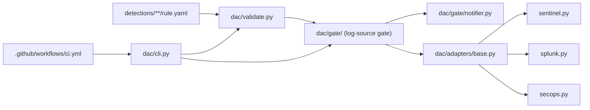

# CLAUDE.md

## Project

Detection-as-code portfolio project: up to 10 detection rules, each
documented as an attack and as a detection, deployed through one
pipeline to Microsoft Sentinel (KQL), Splunk (SPL) and Google SecOps
(YARA-L). No live SIEM exists; everything except API credentials is
built and tested here.

Time-boxed (about 3 weeks from 2026-10-27), not a platform. Before
adding a rule, SIEM, data source or feature beyond the Scope below,
check the request is explicit from the owner (Venu).

## Scope

| # | Track | Rule | Mapping | Targets |
|---|-------|------|---------|---------|
| A1 | endpoint | Encoded / download-cradle PowerShell | T1059.001 | Sentinel, Splunk, SecOps |
| A2 | endpoint | Run-key persistence by a non-installer process | T1547.001 | Sentinel, Splunk, SecOps |
| A3 | endpoint | SAM/SYSTEM hive dump | T1003.002 | Sentinel, Splunk, SecOps |
| A4 | endpoint | LOLBin download (certutil, bitsadmin, curl) | T1105 | Sentinel, Splunk, SecOps |
| B1 | identity | Illicit OAuth consent grant | T1528 | Sentinel |
| B2 | identity | Risky permission or credential added to an app | T1098.001 | Sentinel |
| B3 | identity | Sign-in pattern consistent with token replay | T1550.001 | Sentinel |
| C1 | llm | Prompt-injection patterns | OWASP LLM01 (2025) + ATLAS | Sentinel |
| C2 | llm | Canary secret in model output | OWASP LLM02 (2025) + ATLAS | Sentinel |
| C3 | llm | Abnormal tool-call volume | OWASP LLM06/LLM10 (2025) + ATLAS | Sentinel |

None built yet. ATT&CK IDs above were checked against the enterprise
STIX bundle on 2026-10-27 (all exist, none deprecated). ATLAS IDs are
not yet fetched. No OWASP LLM Top 10 2026 list has been confirmed to
exist; rules use 2025 IDs.

Cut order if behind: Sigma (not started) → C3 → B3. Docs, negative
tests and evidence are never cut.

## Architecture

Hand-authored; update by hand when the pipeline changes.

- `detections/<endpoint|identity|llm>/<ID>-<name>/` - one folder per
  rule: `rule.yaml`, `README.md` (rule doc), `attack.md` (attack doc),
  `tests/positive.json`, `tests/negative.json`, `tests/evidence.md`.
- `schemas/rule.schema.json` - the rule format (ADR 001).
- `log_sources.yaml` / `teams.yaml` - log-source catalogue with owning
  team and per-SIEM names; team contacts (emails empty for now).
- `confirmations/<siem>/<log_source>.yaml` - team confirmations the
  gate checks (ADR 003). None yet.
- `dac/validate.py` - offline checks (docs/components/validation.md).
- `dac/adapters/` - one `SiemAdapter` interface, three adapters
  (ADR 002, docs/components/adapters.md).
- `dac/gate/` - log-source gate and notifiers
  (docs/components/log-source-gate.md).
- `dac/cli.py` - `python -m dac validate | gate | plan | deploy`.
- `.github/workflows/ci.yml` - validate on every push/PR, report-only
  gate on PRs, gated deploy on `main` (docs/components/ci.md).
- `templates/` - attack-doc and rule-doc templates; their `##`
  headings are the ones the validator requires.
- `tests/` - pytest; `tests/fixtures/rules/` holds one pipeline
  fixture rule (not a reviewed detection), `tests/fixtures/api/` holds
  API responses written from vendor docs (not recorded).
- `.claude/skills/` - `build-and-document`, `new-detection`,
  `log-source-gate` (docs/skills.md).

## Conventions

- Every rule ships with its attack doc, rule doc, positive and negative
  samples and evidence in the same PR. CI rejects a missing or
  placeholder section.
- Samples are labelled recorded (with dataset and file) or
  hand-written. Hand-written samples are never presented as attack
  data.
- `evidence.md` records an actual engine run (engine, date, counts). If
  the query was not run, it says so.
- Citations come from fetched primary sources with the fetch date.
  Never cite from memory, never invent campaign details or IDs.
- A check is described by exactly what it tests. List what it misses;
  never say it "closes" a problem.
- Live-API behavior is "not verified" until a live call is made and
  logged in BUILD_LOG.md.
- Secrets only via environment variables / GitHub Actions secrets.
- ADRs and BUILD_LOG.md are append-only; correct with dated amendments.

## Testing

`python -m pytest` from the repo root before every commit, plus
`yamllint .`. CI also runs `python -m dac validate` against the
current MITRE ATT&CK bundle.

- `test_validate.py` - schema, sources, query checks, docs, ATT&CK.
- `test_adapters.py` - query checks and requests per SIEM; deploy
  against a fake transport.
- `test_gate.py` - confirmations, blocking, reminders, notifier choice.
- `test_cli.py` - commands end to end on the fixture rule.

Last run (2026-10-27): 59 passed, 0 failed.

## Model usage

Same convention as attackKnowledgeGraph: Haiku for mechanical runs and
formatting, Sonnet for implementation and drafting from sources in
hand, Opus for judgment calls where a subtle error becomes wrong data
(detection logic trade-offs, ATT&CK/OWASP mapping disputes, reconciling
conflicting sources).

## Current status

- Built: rule schema, validator, three adapters, log-source gate with
  file and SMTP notifiers, CLI, CI workflow, component docs, ADRs
  001-003, templates, skills.
- Verified: everything in the test suite; ATT&CK IDs for the planned
  rules against the STIX bundle.
- Not verified: any live API call (Sentinel, Splunk, SecOps, SMTP);
  the CI workflow on GitHub until its first run; ADX free tier for
  running queries.
- Next: day-1 checks (free query engine, dataset coverage for A1-A4),
  then rule A1 end to end with the `new-detection` skill.

## Do NOT

- Don't add rules, SIEMs or features beyond Scope without the owner's
  explicit go-ahead. Park ideas in BUILD_LOG.md.
- Don't commit a log-source confirmation the owning team did not give.
- Don't describe the dry-run pipeline as deploying to real SIEMs.
- Don't add real API keys, tenant names or customer data.
