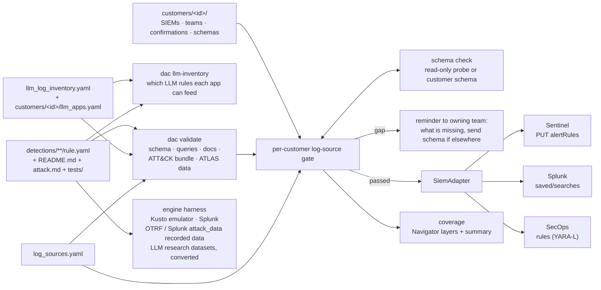

# detection_As_Code

Detection rules as code for Microsoft Sentinel (KQL), Splunk (SPL) and
Google SecOps (YARA-L), deployed per customer through a CI/CD pipeline
that validates each rule, probes each customer's SIEM for the tables
and fields the rule reads, holds back rules whose data is not
confirmed (and tells the owning team exactly what is missing), and
reports per-customer coverage as ATT&CK / ATLAS Navigator layers.

**Status (2026-10-27):** the pipeline is built and tested offline, and
all ten scoped rules are built: four endpoint rules (A1-A4), three Entra
ID identity rules (B1-B3, Sentinel only) and three LLM application rules
(C1-C3, Sentinel only). Their KQL (and the endpoint rules' SPL) has been
run in local engines (Kusto emulator, Splunk Enterprise container)
against recorded open-source data; the endpoint rules' YARA-L has not
run anywhere. **No public recorded LLM-application log exists**: the LLM
rules read this project's own normalised table (`LLMAppLog_CL`, based on
the OpenTelemetry GenAI conventions) and were tested on real prompts and
real agent runs converted into it, so their evidence is weaker; see
[LLM telemetry](docs/components/llm-telemetry.md). No live SIEM exists for this project, so every deploy so far
is a dry-run, and every API call (deploy and probe) is written from
vendor documentation, not verified against a live API.

## Rules

| # | Rule | Mapping | Tier | KQL / SPL tested on recorded data | YARA-L |
|---|---|---|---|---|---|
| A1 | [Encoded / download-cradle PowerShell](detections/endpoint/A1-T1059.001-encoded-powershell/) | T1059.001 | baseline | yes, 2 rows of 45,370 events, both attack | not run |
| A2 | [Run-key persistence outside installer paths](detections/endpoint/A2-T1547.001-run-key-persistence/) | T1547.001 | targeted | yes, 2 rows, both attack | not run |
| A3 | [SAM / SYSTEM / SECURITY hive dump](detections/endpoint/A3-T1003.002-sam-hive-dump/) | T1003.002 | baseline | yes, 2 rows, both attack | not run |
| A4 | [certutil / bitsadmin / curl download](detections/endpoint/A4-T1105-lolbin-download/) | T1105 | baseline | yes, 1 row, attack | not run |
| B1 | [OAuth consent with mailbox / file / directory-write scopes](detections/identity/B1-T1528-illicit-oauth-consent/) | T1528 | baseline | KQL: yes, 2 rows of 87 Entra records, both attack | n/a (Sentinel only) |
| B2 | [Credential or high-risk permission added to an app](detections/identity/B2-T1098.001-app-credential-or-permission/) | T1098.001 | baseline | KQL: yes, 4 rows, all attack or lab test | n/a |
| B3 | [One sign-in session from two countries](detections/identity/B3-T1550.001-session-token-replay/) | T1550.001, T1550.004 | targeted | KQL ran, but **no recorded sign-in has a SessionId**; positives hand-written | n/a |
| C1 | [Prompt-injection phrasing in prompts and tool / retrieval results](detections/llm/C1-AML.T0051-prompt-injection/) | LLM01:2025, LLM01:2026; AML.T0051, T0054, T0056, T0068 | targeted | KQL on converted research data: JailbreakHub jailbreaks 23% caught, regular prompts 1.9% alerted; AgentDojo 231/231 (in-sample); BIPIA 0/75 | n/a |
| C2 | [Canary from hidden context in model output or tool arguments](detections/llm/C2-AML.T0057-canary-in-output/) | LLM02/LLM07:2025, LLM02/LLM08:2026; AML.T0056, T0057, T0086 | targeted | KQL: 5 rows, all the registered secret leaving: both real AgentDojo exfiltrations, plus 3 rows where the user asked for it; no dataset has a planted canary | n/a |
| C3 | [Tool-call volume or loop per agent conversation](detections/llm/C3-AML.T0053-tool-call-volume/) | LLM06/LLM10:2025, LLM03/LLM06:2026; AML.T0053, T0034.002 | targeted | KQL: 0 alerts on 300 real agent runs; positives hand-written (no recorded runaway agent exists) | n/a |

Each folder has the attack doc (`attack.md`), the rule doc
(`README.md`), labelled samples and `tests/evidence.md`. "Tested" means
lab data in emulated engines, not a production false-positive rate; see
[engine tests](docs/components/engine-tests.md). Endpoint data is OTRF
Security-Datasets (MIT); Entra data is Splunk attack_data (Apache 2.0)
and OTRF's Golden SAML audit export; LLM data is JailbreakHub, AgentDojo
and BIPIA (all MIT). OWASP numbers differ between the 2025 and 2026 LLM
lists (Excessive Agency is LLM06:2025 but LLM03:2026), so both are given.

## Architecture

Hand-authored; update when the pipeline changes.



## What each part proves

| Part | Proves | Does not prove |
|---|---|---|
| `dac validate` | rule is well-formed, references its declared sources, docs and evidence files exist and are filled, ATT&CK IDs and tactics are real, ATLAS IDs are real, LLM rules declare the telemetry they need | that a query is valid in its language, or fires on the samples |
| Schema check (probe) | the table / source exists, had events in 24h, and has every field the rule reads, at the time of the run | that field values are usable; probes are unverified against live APIs |
| Log-source gate | each source passed a probe, or (without a probe) the owning team confirmed it within 90 days | on the human path, that events are arriving now |
| Coverage | which techniques have at least one gate-passed rule per customer | that the rule actually catches the technique |
| Adapter tests | requests match the vendor API references as we read them | that a live API accepts them |
| Engine tests (`python -m harness`) | the deployed KQL / SPL text matches every positive sample, no negative, and only the attack events in the recorded data, in the Kusto emulator and a local Splunk | Log Analytics or Splunk-add-on behaviour exactly; false-positive rate in production; anything about YARA-L |
| `dac llm-inventory` | per customer LLM app, which LLM rules its stated log sources and content-capture setting can feed, and what is missing | that the app really logs what its owner and the inventory say |
| `tests/evidence.md` per rule | the engine, dataset, counts and caveats of that run | anything about a production tenant |

## Quick start

```bash
python -m venv .venv && . .venv/bin/activate
pip install -r requirements-dev.txt
python -m pytest
mkdir -p data && curl -sSfL -o data/enterprise-attack.json \
  https://raw.githubusercontent.com/mitre-attack/attack-stix-data/master/enterprise-attack/enterprise-attack.json
curl -sSfL -o data/ATLAS-2026.06.yaml \
  https://raw.githubusercontent.com/mitre-atlas/atlas-data/3259f388d19cbcca11bacf12a0ef97f4198f711b/dist/v6/ATLAS-2026.06.yaml
python -m dac validate --attack-bundle data/enterprise-attack.json --atlas-data data/ATLAS-2026.06.yaml
python -m dac llm-inventory --customer demo   # which LLM rules each LLM app can feed
F="--rules-dir tests/fixtures/rules --customers-dir tests/fixtures/customers"
python -m dac $F schema-check --customer acme --siem sentinel
python -m dac $F gate --customer acme --siem sentinel --report-only
python -m dac $F coverage --customer acme
python -m dac $F plan --siem secops
# Engine tests (needs Docker; see docs/components/engine-tests.md)
docker run -d -e ACCEPT_EULA=Y -p 8080:8080 mcr.microsoft.com/azuredataexplorer/kustainer-linux:latest
python -m harness fetch && python -m harness run --engine kusto
```

## Docs
- Components: [validation](docs/components/validation.md),
  [adapters](docs/components/adapters.md),
  [schema check](docs/components/schema-check.md),
  [log-source gate](docs/components/log-source-gate.md),
  [coverage](docs/components/coverage.md),
  [engine tests](docs/components/engine-tests.md),
  [LLM telemetry and log inventory](docs/components/llm-telemetry.md),
  [CI/CD](docs/components/ci.md)
- Decisions: [docs/decisions/](docs/decisions/)
- Templates for every rule: [attack doc](templates/attack-doc.md),
  [rule doc](templates/rule-doc.md)
- Claude Code skills used to build this: [docs/skills.md](docs/skills.md)
- Build history: [BUILD_LOG.md](BUILD_LOG.md)
