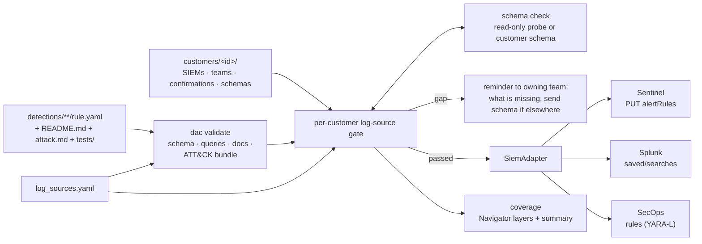

# detection_As_Code

Detection rules as code for Microsoft Sentinel (KQL), Splunk (SPL) and
Google SecOps (YARA-L), deployed per customer through a CI/CD pipeline
that validates each rule, probes each customer's SIEM for the tables
and fields the rule reads, holds back rules whose data is not
confirmed (and tells the owning team exactly what is missing), and
reports per-customer coverage as ATT&CK / ATLAS Navigator layers.

**Status (2026-10-27):** the pipeline is built and tested offline. No
detection rules yet; the 10 planned rules are listed in CLAUDE.md. No
live SIEM exists for this project, so every deploy so far is a
dry-run, and every API call (deploy and probe) is written from vendor
documentation, not verified against a live API.

## Architecture

Hand-authored; update when the pipeline changes.



## What each part proves

| Part | Proves | Does not prove |
|---|---|---|
| `dac validate` | rule is well-formed, references its declared sources, docs and evidence files exist and are filled, ATT&CK IDs and tactics are real | that a query is valid in its language, or fires on the samples |
| Schema check (probe) | the table / source exists, had events in 24h, and has every field the rule reads, at the time of the run | that field values are usable; probes are unverified against live APIs |
| Log-source gate | each source passed a probe, or (without a probe) the owning team confirmed it within 90 days | on the human path, that events are arriving now |
| Coverage | which techniques have at least one gate-passed rule per customer | that the rule actually catches the technique |
| Adapter tests | requests match the vendor API references as we read them | that a live API accepts them |
| `tests/evidence.md` per rule | the result of running the query in an engine, recorded by hand | anything about a production tenant |

## Quick start

```bash
python -m venv .venv && . .venv/bin/activate
pip install -r requirements-dev.txt
python -m pytest
mkdir -p data && curl -sSfL -o data/enterprise-attack.json \
  https://raw.githubusercontent.com/mitre-attack/attack-stix-data/master/enterprise-attack/enterprise-attack.json
python -m dac validate --attack-bundle data/enterprise-attack.json
F="--rules-dir tests/fixtures/rules --customers-dir tests/fixtures/customers"
python -m dac $F schema-check --customer acme --siem sentinel
python -m dac $F gate --customer acme --siem sentinel --report-only
python -m dac $F coverage --customer acme
python -m dac $F plan --siem secops
```

## Docs
- Components: [validation](docs/components/validation.md),
  [adapters](docs/components/adapters.md),
  [schema check](docs/components/schema-check.md),
  [log-source gate](docs/components/log-source-gate.md),
  [coverage](docs/components/coverage.md),
  [CI/CD](docs/components/ci.md)
- Decisions: [docs/decisions/](docs/decisions/)
- Templates for every rule: [attack doc](templates/attack-doc.md),
  [rule doc](templates/rule-doc.md)
- Claude Code skills used to build this: [docs/skills.md](docs/skills.md)
- Build history: [BUILD_LOG.md](BUILD_LOG.md)
