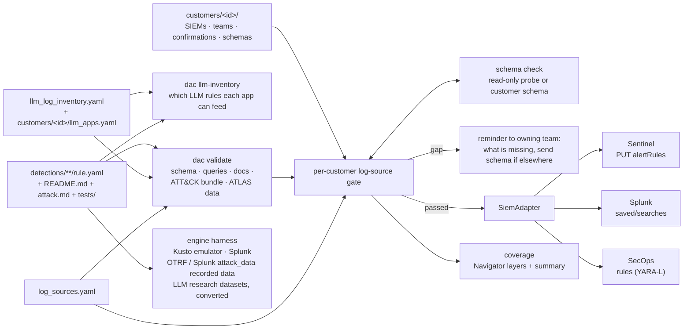

# detection_As_Code

Detection rules as code for Microsoft Sentinel (KQL), Splunk (SPL) and
Google SecOps (YARA-L), deployed per customer through a CI/CD pipeline
that validates each rule, probes each customer's SIEM for the tables
and fields the rule reads, holds back rules whose data is not
confirmed (and tells the owning team exactly what is missing), and
reports per-customer coverage as ATT&CK / ATLAS Navigator layers.

**Status (2026-10-27):** the pipeline is built and tested offline, and
all ten scoped rules are built: four endpoint rules (A1-A4), three Entra
ID identity rules (B1-B3, Sentinel only) and three LLM application rules
(C1-C3, Sentinel only). On 2026-11-07 four more identity rules were
added at the owner's request for the ARTEX Phase 1 blog post (B4-B7,
leaked app secrets; docs/threats/artex-phase1-credential-sourcing.md),
with a self-search runbook (docs/hunts/H1), four recon rules for the Phase 2 post (D1-D4: decoy route, documents then routes the UI does not call, path sweep, AWS permission burst; docs/threats/artex-phase2-recon.md), and six identity rules for the Phase 3 post (B8-B13: Entra and Okta sprays counted per account, one network across several login flows, SSPR for many users, legacy auth / ROPC, and a schema-dependent OAuth/JWT tampering rule; docs/threats/artex-phase3-identity.md). Eight experimental foothold rules for the Phase 4 post (E1-E6, E8, E9: IDOR record walking, server process starting a shell, script file in a web root, App Service publishing login, request-capture egress; docs/threats/artex-phase4-foothold.md) have no samples yet. Their KQL (and the endpoint rules' SPL) has been
run in local engines (Kusto emulator, Splunk Enterprise container)
against recorded open-source data; the endpoint rules' YARA-L has not
run anywhere. **No public recorded LLM-application log exists**: the LLM
rules read this project's own normalised table (`LLMAppLog_CL`, based on
the OpenTelemetry GenAI conventions) and were tested on real prompts and
real agent runs converted into it, so their evidence is weaker; see
[LLM telemetry](docs/components/llm-telemetry.md). No live SIEM exists for this project, so every deploy so far
is a dry-run, and every API call (deploy and probe) is written from
vendor documentation, not verified against a live API.

## Rules

| # | Rule | Mapping | Tier | KQL / SPL tested on recorded data | YARA-L |
|---|---|---|---|---|---|
| A1 | [Encoded / download-cradle PowerShell](detections/endpoint/A1-T1059.001-encoded-powershell/) | T1059.001 | baseline | yes, 2 rows of 45,370 events, both attack | not run |
| A2 | [Run-key persistence outside installer paths](detections/endpoint/A2-T1547.001-run-key-persistence/) | T1547.001 | targeted | yes, 2 rows, both attack | not run |
| A3 | [SAM / SYSTEM / SECURITY hive dump](detections/endpoint/A3-T1003.002-sam-hive-dump/) | T1003.002 | baseline | yes, 2 rows, both attack | not run |
| A4 | [certutil / bitsadmin / curl download](detections/endpoint/A4-T1105-lolbin-download/) | T1105 | baseline | yes, 1 row, attack | not run |
| B1 | [OAuth consent with mailbox / file / directory-write scopes](detections/identity/B1-T1528-illicit-oauth-consent/) | T1528 | baseline | KQL: yes, 2 rows of 87 Entra records, both attack | n/a (Sentinel only) |
| B2 | [Credential or high-risk permission added to an app](detections/identity/B2-T1098.001-app-credential-or-permission/) | T1098.001 | baseline | KQL: yes, 4 rows, all attack or lab test | n/a |
| B3 | [One sign-in session from two countries](detections/identity/B3-T1550.001-session-token-replay/) | T1550.001, T1550.004 | targeted | KQL ran, but **no recorded sign-in has a SessionId**; positives hand-written | n/a |
| B4 | [Honeytoken app credential or decoy Key Vault object used](detections/identity/B4-T1078.004-honeytoken-credential-use/) | T1078.004, T1555.006 | targeted | KQL ran; no recorded honeytoken or Key Vault data; positives hand-written | n/a |
| B5 | [One SP credential from Microsoft's network and outside it](detections/identity/B5-T1078.004-credential-two-networks/) | T1078.004 | targeted | KQL ran, but **no recorded SP sign-in has an ASN**; positives hand-written | n/a |
| B6 | [SP sign-in from an ASN new in 14 days](detections/identity/B6-T1078.004-sp-new-network/) | T1078.004 | targeted | KQL ran, but no recorded ASN or 14-day history; positives hand-written | n/a |
| B7 | [SP Graph calls unlike its app](detections/identity/B7-T1087.004-sp-unlike-its-app/) | T1087.004, T1069.003, T1526 | targeted | KQL ran; 27 recorded Graph calls, no baseline possible; positives hand-written | n/a |
| B8 | [Entra spray counted per account](detections/identity/B8-T1110.003-entra-account-side-spray/) | T1110.003 | targeted | KQL: both recorded Entra sprays caught (31 accounts from 30 IPs; 31 from one IP), one-account brute force not; re-targeting only on hand-written samples | n/a |
| B9 | [Okta spray counted per account](detections/identity/B9-T1110.003-okta-account-side-spray/) | T1110.003 | targeted | KQL: 0 rows on the only recorded Okta spray (10 accounts, below the threshold); positives hand-written | n/a |
| B10 | [One network across several Entra login flows](detections/identity/B10-T1110.003-one-client-many-login-flows/) | T1110.003, T1589 | targeted | KQL ran on hand-written samples only; no recorded set combines the flows | n/a |
| B11 | [SSPR for several users from one network](detections/identity/B11-T1589-recovery-for-many-users/) | T1589 | targeted | KQL ran on hand-written samples only; no recorded SSPR event | n/a |
| B12 | [Legacy auth / ROPC probing](detections/identity/B12-T1110.003-legacy-auth-probing/) | T1110.003, T1078.004 | targeted | KQL: 1 row on recorded data, the MFASweep ROPC attempts (password accepted, MFA required); legacy branch hand-written | n/a |
| B13 | [Unsigned JWT / OAuth callback tampering](detections/identity/B13-T1606-oauth-jwt-tampering/) | T1606, T1190 | targeted | **Schema-dependent**: reads `AppAuthEvent_CL`, which an app must write; KQL ran on hand-written samples only | n/a |
| D1 | [Request to a decoy API route](detections/recon/D1-T1595-decoy-route-hit/) | T1595, T1594 | targeted | KQL ran on hand-written samples only; no recorded web access log with a decoy | n/a |
| D2 | [Source map / Swagger / config download, then routes the UI does not call](detections/recon/D2-T1594-docs-then-novel-api/) | T1594, T1595 | targeted | KQL ran on hand-written samples only (baseline and attack); no recorded web log | n/a |
| D3 | [One client, dozens of distinct paths in minutes, mostly 401/403/404](detections/recon/D3-T1595.003-failing-path-sweep/) | T1595.003 | targeted | KQL ran on hand-written samples only; thresholds are this project's | n/a |
| D4 | [AccessDenied burst across AWS services from one principal](detections/recon/D4-T1580-cloud-permission-burst/) | T1580 | targeted | KQL: 11 rows on 6,417 recorded CloudTrail events, all one scanner user (cloudsploit, a lab tool, not ARTEX); ordinary users no rows | n/a |
| E1 | [One client reads many record IDs in sequence or with many denials](detections/foothold/E1-T1190-sequential-record-access/) | T1190 | targeted, experimental | Not run; no samples | n/a |
| E2 | [Web or database process starts a shell or download tool (Defender)](detections/foothold/E2-T1505.003-web-process-shell-mde/) | T1505.003, T1059 | targeted, experimental | Not run; no samples | n/a |
| E3 | [Same, Windows Sysmon](detections/foothold/E3-T1505.003-web-process-shell-sysmon/) | T1505.003, T1059 | targeted, experimental | KQL: 1 row on 9 recorded Sysmon events (w3wp starting cmd, WSUS lab); no samples | n/a |
| E4 | [Same, Sysmon for Linux](detections/foothold/E4-T1505.003-web-process-shell-linux-sysmon/) | T1505.003, T1059.004 | targeted, experimental | KQL: 0 rows on 42 recorded events (a Maven build, excluded as intended); never matched | n/a |
| E5 | [Script file in a web root (Defender)](detections/foothold/E5-T1505.003-webroot-script-file-mde/) | T1505.003 | targeted, experimental | Not run; no samples | n/a |
| E6 | [Script file in a web root (Windows Sysmon)](detections/foothold/E6-T1505.003-webroot-script-file-sysmon/) | T1505.003 | targeted, experimental | KQL: 7 rows on 7 recorded events (SharePoint, MOVEit web shell files); no false-positive data | n/a |
| E8 | [App Service publishing login by a non-pipeline identity](detections/foothold/E8-T1078.004-app-service-publishing-login/) | T1078.004 | targeted, experimental | Not run; no samples | n/a |
| E9 | [Server connects to a request-capture service](detections/foothold/E9-T1567.004-request-capture-egress/) | T1567.004 | targeted, experimental | Not run; no samples | n/a |
| C1 | [Prompt-injection phrasing in prompts and tool / retrieval results](detections/llm/C1-AML.T0051-prompt-injection/) | LLM01:2025, LLM01:2026; AML.T0051, T0054, T0056, T0068 | targeted | KQL on converted research data: JailbreakHub jailbreaks 23% caught, regular prompts 1.9% alerted; AgentDojo 231/231 (in-sample); BIPIA 0/75 | n/a |
| C2 | [Canary from hidden context in model output or tool arguments](detections/llm/C2-AML.T0057-canary-in-output/) | LLM02/LLM07:2025, LLM02/LLM08:2026; AML.T0056, T0057, T0086 | targeted | KQL: 5 rows, all the registered secret leaving: both real AgentDojo exfiltrations, plus 3 rows where the user asked for it; no dataset has a planted canary | n/a |
| C3 | [Tool-call volume or loop per agent conversation](detections/llm/C3-AML.T0053-tool-call-volume/) | LLM06/LLM10:2025, LLM03/LLM06:2026; AML.T0053, T0034.002 | targeted | KQL: 0 alerts on 300 real agent runs; positives hand-written (no recorded runaway agent exists) | n/a |

Each folder has the attack doc (`attack.md`), the rule doc
(`README.md`), labelled samples and `tests/evidence.md`. "Tested" means
lab data in emulated engines, not a production false-positive rate; see
[engine tests](docs/components/engine-tests.md). Endpoint data is OTRF
Security-Datasets (MIT); Entra data is Splunk attack_data (Apache 2.0)
and OTRF's Golden SAML audit export; LLM data is JailbreakHub, AgentDojo
and BIPIA (all MIT). OWASP numbers differ between the 2025 and 2026 LLM
lists (Excessive Agency is LLM06:2025 but LLM03:2026), so both are given.

## Architecture

Hand-authored; update when the pipeline changes.



## What each part proves

| Part | Proves | Does not prove |
|---|---|---|
| `dac validate` | rule is well-formed, references its declared sources, docs and evidence files exist and are filled, ATT&CK IDs and tactics are real, ATLAS IDs are real, LLM rules declare the telemetry they need | that a query is valid in its language, or fires on the samples |
| Schema check (probe) | the table / source exists, had events in 24h, and has every field the rule reads, at the time of the run | that field values are usable; probes are unverified against live APIs |
| Log-source gate | each source passed a probe, or (without a probe) the owning team confirmed it within 90 days | on the human path, that events are arriving now |
| Coverage | which techniques have at least one gate-passed rule per customer | that the rule actually catches the technique |
| Adapter tests | requests match the vendor API references as we read them | that a live API accepts them |
| Engine tests (`python -m harness`) | the deployed KQL / SPL text matches every positive sample, no negative, and only the attack events in the recorded data, in the Kusto emulator and a local Splunk | Log Analytics or Splunk-add-on behaviour exactly; false-positive rate in production; anything about YARA-L |
| `dac llm-inventory` | per customer LLM app, which LLM rules its stated log sources and content-capture setting can feed, and what is missing | that the app really logs what its owner and the inventory say |
| `tests/evidence.md` per rule | the engine, dataset, counts and caveats of that run | anything about a production tenant |

## Quick start

```bash
python -m venv .venv && . .venv/bin/activate
pip install -r requirements-dev.txt
python -m pytest
mkdir -p data && curl -sSfL -o data/enterprise-attack.json \
  https://raw.githubusercontent.com/mitre-attack/attack-stix-data/master/enterprise-attack/enterprise-attack.json
curl -sSfL -o data/ATLAS-2026.06.yaml \
  https://raw.githubusercontent.com/mitre-atlas/atlas-data/3259f388d19cbcca11bacf12a0ef97f4198f711b/dist/v6/ATLAS-2026.06.yaml
python -m dac validate --attack-bundle data/enterprise-attack.json --atlas-data data/ATLAS-2026.06.yaml
python -m dac llm-inventory --customer demo   # which LLM rules each LLM app can feed
F="--rules-dir tests/fixtures/rules --customers-dir tests/fixtures/customers"
python -m dac $F schema-check --customer acme --siem sentinel
python -m dac $F gate --customer acme --siem sentinel --report-only
python -m dac $F coverage --customer acme
python -m dac $F plan --siem secops
# Engine tests (needs Docker; see docs/components/engine-tests.md)
docker run -d -e ACCEPT_EULA=Y -p 8080:8080 mcr.microsoft.com/azuredataexplorer/kustainer-linux:latest
python -m harness fetch && python -m harness run --engine kusto
```

## Docs
- Components: [validation](docs/components/validation.md),
  [adapters](docs/components/adapters.md),
  [schema check](docs/components/schema-check.md),
  [log-source gate](docs/components/log-source-gate.md),
  [coverage](docs/components/coverage.md),
  [engine tests](docs/components/engine-tests.md),
  [LLM telemetry and log inventory](docs/components/llm-telemetry.md),
  [CI/CD](docs/components/ci.md)
- Decisions: [docs/decisions/](docs/decisions/)
- Templates for every rule: [attack doc](templates/attack-doc.md),
  [rule doc](templates/rule-doc.md)
- Claude Code skills used to build this: [docs/skills.md](docs/skills.md)
- Build history: [BUILD_LOG.md](BUILD_LOG.md)
