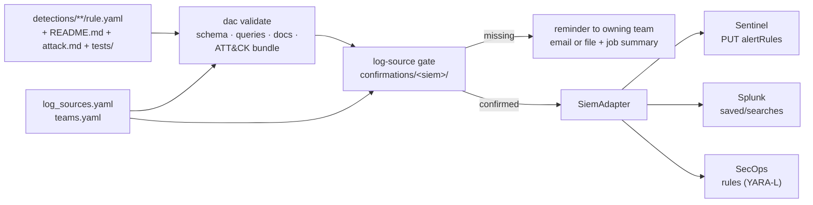

# detection_As_Code

Detection rules as code for Microsoft Sentinel (KQL), Splunk (SPL) and
Google SecOps (YARA-L), with a CI/CD pipeline that validates each rule,
checks that its log sources are confirmed by the owning team, and
deploys it.

**Status (2026-10-27):** the pipeline is built and tested offline. No
detection rules yet; the 10 planned rules are listed in CLAUDE.md. No
live SIEM exists for this project, so every deploy so far is a
dry-run, and the API calls are written from vendor documentation, not
verified against a live API.

## Architecture

Hand-authored; update when the pipeline changes.



## What each part proves

| Part | Proves | Does not prove |
|---|---|---|
| `dac validate` | rule is well-formed, references its declared sources, docs and evidence files exist and are filled, ATT&CK IDs and tactics are real | that a query is valid in its language, or fires on the samples |
| Log-source gate | the owning team confirmed each source within 90 days | that events are arriving now |
| Adapter tests | requests match the vendor API references as we read them | that a live API accepts them |
| `tests/evidence.md` per rule | the result of running the query in an engine, recorded by hand | anything about a production tenant |

## Quick start

```bash
python -m venv .venv && . .venv/bin/activate
pip install -r requirements-dev.txt
python -m pytest
mkdir -p data && curl -sSfL -o data/enterprise-attack.json \
  https://raw.githubusercontent.com/mitre-attack/attack-stix-data/master/enterprise-attack/enterprise-attack.json
python -m dac validate --attack-bundle data/enterprise-attack.json
python -m dac --rules-dir tests/fixtures/rules gate --siem sentinel --report-only
python -m dac --rules-dir tests/fixtures/rules plan --siem secops
```

## Docs
- Components: [validation](docs/components/validation.md),
  [adapters](docs/components/adapters.md),
  [log-source gate](docs/components/log-source-gate.md),
  [CI/CD](docs/components/ci.md)
- Decisions: [docs/decisions/](docs/decisions/)
- Templates for every rule: [attack doc](templates/attack-doc.md),
  [rule doc](templates/rule-doc.md)
- Claude Code skills used to build this: [docs/skills.md](docs/skills.md)
- Build history: [BUILD_LOG.md](BUILD_LOG.md)
