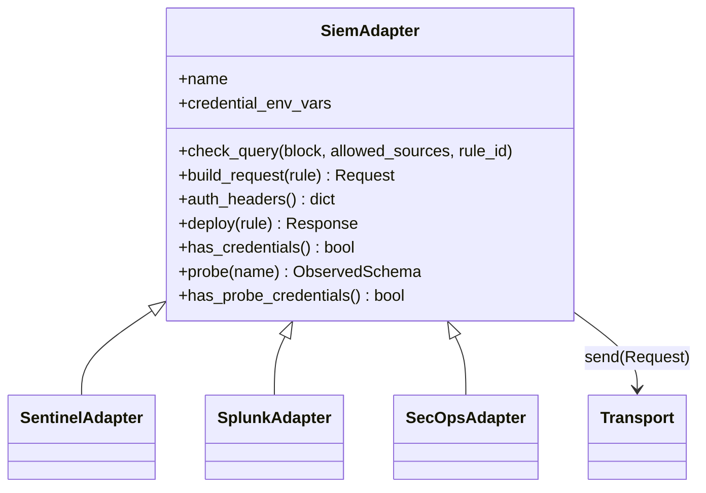

# SIEM adapters

Code: `dac/adapters/`. Decision record: [ADR 002](../decisions/002-adapter-interface.md).

## What it does
Turns one rule into the API request that creates or updates it in
Microsoft Sentinel, Splunk or Google SecOps, and sends it when
credentials exist.

## How it works


| | Sentinel | Splunk | Google SecOps |
|---|---|---|---|
| Language | KQL | SPL | YARA-L 2.0 |
| Object created | Scheduled analytics rule | Scheduled saved search with alert | Detection rule |
| Request | `PUT .../alertRules/<uuid>` | `POST .../saved/searches` (update on 409) | list rules, then `POST .../rules` or `PATCH <rule>` |
| Keyed on | rule UUID in the URL | name `dac_<uuid>` | rule name `dac_<uuid_underscored>` |
| Auth | Entra ID app, client-credentials token | Splunk auth token (Bearer) | short-lived OAuth token from workload identity |
| Read-only probe | Log Analytics query API (`getschema`, 24h count) | export search with `fieldsummary` | UDM search, 100-event sample (least certain) |
| Probe env vars | `AZURE_TENANT_ID`, `AZURE_CLIENT_ID`, `AZURE_CLIENT_SECRET`, `SENTINEL_WORKSPACE_ID` (GUID) | `SPLUNK_URL`, `SPLUNK_TOKEN` | same as deploy |
| Env vars | `AZURE_TENANT_ID`, `AZURE_CLIENT_ID`, `AZURE_CLIENT_SECRET`, `SENTINEL_SUBSCRIPTION_ID`, `SENTINEL_RESOURCE_GROUP`, `SENTINEL_WORKSPACE` | `SPLUNK_URL`, `SPLUNK_TOKEN`, optional `SPLUNK_APP` | `SECOPS_PROJECT`, `SECOPS_REGION`, `SECOPS_INSTANCE`, `SECOPS_ACCESS_TOKEN` |

Mapping details worth knowing:
- ATT&CK tactics become Sentinel's enum (`credential-access` →
  `CredentialAccess`); sub-techniques are sent as their parent
  (`T1059.001` → `T1059`), because that is what the `techniques` field
  takes.
- `status: experimental` deploys the rule disabled in Sentinel and
  Splunk. SecOps rules are created without live detection turned on in
  any status; enabling them is a manual step.
- YARA-L is not YARA. YARA matches byte patterns in files; YARA-L is
  SecOps' language for matching UDM log events over time.

Credentials are per customer: CI runs each customer's jobs in a GitHub
Environment named after the customer, so the names above hold that
customer's values (ADR 004). The probe is described in
docs/components/schema-check.md.

## Why this method
One interface means the gate, dry-run, redaction and credential checks
are written once, and a fourth SIEM is one new class. Building the
request separately from sending it lets dry-run show exactly what
would be sent, which is also the main thing a reviewer wants to see.
Plain stdlib HTTP instead of three vendor SDKs keeps the requests
visible and the dependencies at two packages.

## Advantages
- Every deploy is reviewable before it happens (`build/<siem>/*.json`).
- Re-running a deploy is safe: each SIEM's rule is keyed on our UUID.
- No secret is ever printed: dry-run output redacts `Authorization`,
  and a failed Sentinel token request reports only the HTTP status.

## What it does not do
- Not verified against any live API. Endpoints, API versions and field
  names come from vendor references; see `tests/fixtures/api/README.md`.
- `check_query` is not a language parser (see validation.md).
- No deletion: removing a rule from the repo does not remove it from
  the SIEM.

## How to use
```bash
python -m dac plan --siem sentinel                # write requests, no gate
python -m dac deploy --customer demo --siem sentinel   # gate, then dry-run
SPLUNK_URL=... SPLUNK_TOKEN=... python -m dac deploy --customer demo --siem splunk --mode live
```
