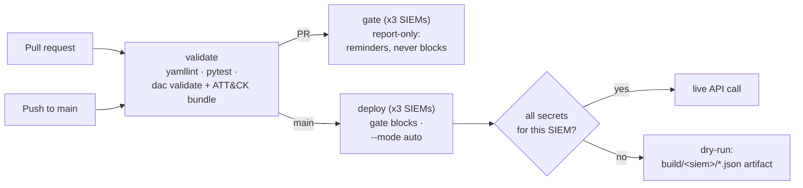

# CI/CD pipeline

Code: `.github/workflows/ci.yml`.

## What it does
Runs validation and tests on every push and PR, sends log-source
reminders on PRs, and deploys to each SIEM on merge to `main`: live
where that SIEM's secrets exist, dry-run where they do not.

## How it works

- **validate**: `yamllint .`, `pytest`, then `python -m dac validate`
  against MITRE's enterprise ATT&CK bundle, downloaded from
  `mitre-attack/attack-stix-data` and cached per ISO week.
- **gate** (PRs only): one job per SIEM, report-only, so the PR shows
  which teams were reminded and the reminders are uploaded as
  artifacts.
- **deploy** (push to `main` only): one job per SIEM. The gate blocks
  unconfirmed rules (job exits 2, shown red), confirmed rules still
  deploy. For SecOps, a workload-identity step mints a short-lived
  token only when `GCP_WORKLOAD_IDENTITY_PROVIDER` is set.

## Secrets to add when a SIEM exists
Repository → Settings → Secrets and variables → Actions. Names are in
docs/components/adapters.md, plus `SMTP_HOST`, `SMTP_PORT`,
`SMTP_FROM`, `SMTP_USER`, `SMTP_PASSWORD` for email reminders and
`GCP_WORKLOAD_IDENTITY_PROVIDER`, `GCP_SERVICE_ACCOUNT` for SecOps.
No secret is needed for anything else in the pipeline.

## Why this method
One workflow, three jobs, so a reviewer can read the whole pipeline in
one file. The matrix keeps the SIEMs independent: a Splunk failure
does not stop a Sentinel deploy. `--mode auto` means the same workflow
is correct both now (no secrets, dry-run) and later (secrets set, live)
with no edit.

## What it does not prove
- That any query is valid in its SIEM or fires on the samples (see
  validation.md).
- That a live API accepts the requests: no live deploy has run.
- Fork PRs get no secrets, so their gate job never emails.
