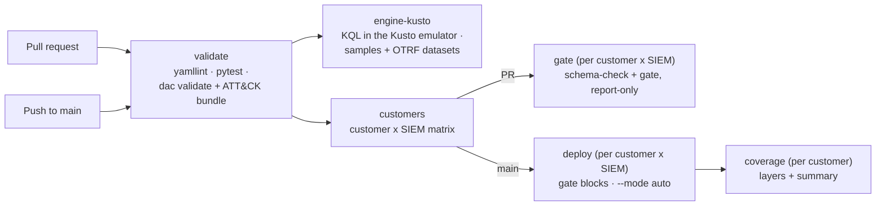

# CI/CD pipeline

Code: `.github/workflows/ci.yml`.

## What it does
Validates and tests every push and PR. On PRs, it runs the schema check
and the log-source gate for every customer and SIEM, so teams get
reminders while the rule is in review. On `main`, it deploys per
customer and SIEM (live where that customer's secrets exist, dry-run
otherwise) and regenerates each customer's coverage.

## How it works

- **validate**: `yamllint .`, `pytest`, `python -m dac validate`
  against MITRE's enterprise ATT&CK bundle (cached per ISO week).
- **engine-kusto**: starts the Azure Data Explorer emulator as a
  service container (pinned by digest), fetches the recorded datasets
  (SHA-256 checked) and runs `python -m harness run --engine kusto`:
  every rule's Sentinel query against its samples and datasets, failing
  on a missed positive, a matched negative, or a dataset count that
  differs from the committed result (docs/components/engine-tests.md).
  The Splunk engine test is not in CI.
- **customers**: `python -m dac customers --json` turns
  `customers/*/customer.yaml` into the job matrix.
- **gate** (PRs): per customer and SIEM, the schema check (report) and
  the gate in report-only mode. Reminders and the schema report are
  uploaded as artifacts.
- **deploy** (push to `main`): per customer and SIEM, gate then deploy
  with `--mode auto`. Blocked rules make the job exit 2 (red); allowed
  rules still deploy. SecOps tokens are minted by workload identity only
  when configured.
- **coverage** (push to `main`): per customer, Navigator layers and the
  summary, shown in the job summary and uploaded.

## Secrets, per customer
Each customer is a GitHub **Environment** named after its folder
(`customers/demo/` -> Environment `demo`). Its secrets use the plain
names: `AZURE_TENANT_ID`, `AZURE_CLIENT_ID`, `AZURE_CLIENT_SECRET`,
`SENTINEL_SUBSCRIPTION_ID`, `SENTINEL_RESOURCE_GROUP`,
`SENTINEL_WORKSPACE`, `SENTINEL_WORKSPACE_ID`, `SPLUNK_URL`,
`SPLUNK_TOKEN`, `SPLUNK_APP`, `SECOPS_PROJECT`, `SECOPS_REGION`,
`SECOPS_INSTANCE`, `GCP_WORKLOAD_IDENTITY_PROVIDER`,
`GCP_SERVICE_ACCOUNT`, and `SMTP_*` for email. A job for one customer
cannot read another customer's secrets. Least privilege: probe-only
(read) access is enough for the PR gate job; deploy needs write.

## Why this method
One workflow file, readable top to bottom. The matrix keeps customers
and SIEMs independent: one customer's failure does not stop another's
deploy. `--mode auto` means the same workflow is right both now (no
secrets, dry-run) and later (secrets set, live) with no edit.
Environments give per-customer secret isolation without custom code.

## What it does not prove
- That any query is valid in its real SIEM: KQL runs in the ADX
  emulator, not Log Analytics; SPL and YARA-L are not run in CI.
- That a live API accepts the requests: no live deploy or probe has run.
- Fork PRs get no secrets, so their gate job never probes or emails.
- The PR gate job uses the same Environment as deploy; if deploy
  secrets have write access, so does the PR job. Splitting read and
  write into two Environments per customer is the stricter setup.
