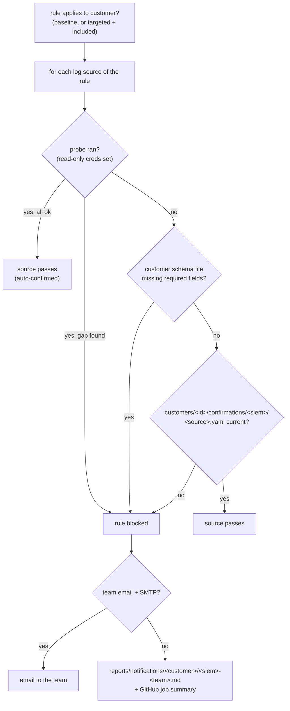

# Log-source gate

Code: `dac/gate/`. Decision records: [ADR 003](../decisions/003-log-source-gate.md)
(and its amendment), [ADR 004](../decisions/004-customers-and-baseline.md),
[ADR 005](../decisions/005-schema-check.md).

## What it does
Before a rule is deployed to a customer's SIEM, it checks that every
log source the rule depends on is really there for that customer:
by querying the SIEM when it can, by a committed confirmation from the
owning team when it cannot. If a source does not pass, the rule is held
back and the owning team gets a reminder saying exactly what is
missing.

## How it works


1. Only rules that apply to the customer are gated: baseline rules not
   in `exclude`, and targeted rules in `include`. SIEMs the customer
   does not run are skipped.
2. The schema check (docs/components/schema-check.md) runs for each
   table / source / log type in the rule's `required_fields`.
3. Per log source: a probe result decides when there is one (pass or
   block, even over a human confirmation). Without a probe, a customer
   schema file missing fields blocks, and otherwise a current human
   confirmation is required: matching `log_source` and `siem`, a
   `confirmed_by`, and `confirmed_on` not in the future and at most 90
   days old.
4. Blocked sources are grouped by owning team: one reminder per team,
   listing each source, where it is expected in that SIEM, what was
   found, the rules waiting and the fields they read, and an ask in
   that SIEM's terms ("a different table such as Syslog or
   CommonSecurityLog" for Sentinel, "a different index, source or
   sourcetype" for Splunk, "a different log type or UDM mapping" for
   SecOps) to send the actual schema if the data lands elsewhere.

A human confirmation file:
```yaml
log_source: windows-process-creation
siem: sentinel
confirmed_by: Endpoint Engineering (A. Person)
confirmed_on: 2026-10-27
evidence: SecurityEvent has 4688 rows with CommandLine from all servers in the last 24h
```

## Why this method
A rule against a missing or incomplete source fails silently: no
error, no alerts. Querying the SIEM is the only check that sees the
data itself, so a probe result wins whenever one exists. Where no probe
can run, the team that owns the source is asked, at the point where it
matters, and their answer is recorded in git. Confirming per source,
not per rule, means one answer covers every rule on that source.

## Advantages
- Silent detection failures become a visible, blocked deploy with a
  named owner and an exact gap.
- With read-only credentials, onboarding a customer to baseline rules
  needs no human step at all.
- The reminder reaches the team on the PR, before the rule is live.
- Email is one field in `teams.yaml` plus the `SMTP_*` secrets.

## What it does not do
- On the human path, it proves a person confirmed the source within 90
  days, not that events are arriving now.
- Probes are unverified against live APIs (see schema-check.md).
- No deduplication: every run while a source is blocked re-sends.
- It does not check that `confirmed_by` belongs to the owning team; PR
  review (or CODEOWNERS on `customers/*/confirmations/`) has to.

## How to use
```bash
python -m dac gate --customer demo --siem sentinel                # exit 2 if anything is blocked
python -m dac gate --customer demo --siem sentinel --report-only  # PR mode
```
The `log-source-gate` and `schema-check` Claude skills walk through
unblocking.
