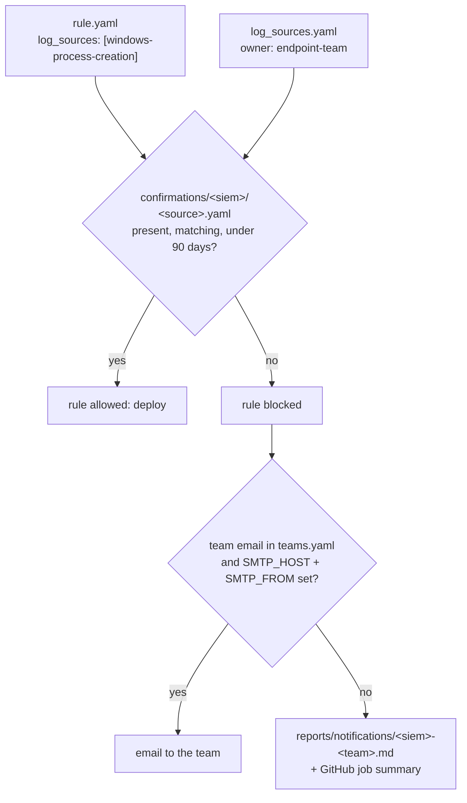

# Log-source gate

Code: `dac/gate/`. Decision record: [ADR 003](../decisions/003-log-source-gate.md).

## What it does
Before a rule is deployed to a SIEM, it checks that the team owning
each of the rule's log sources has confirmed the source is onboarded in
that SIEM. If not, it reminds the team and holds back that rule.

## How it works


1. For each rule that targets the SIEM, for each log source it lists,
   look for `confirmations/<siem>/<source>.yaml`.
2. The confirmation must name the same source and SIEM, have a
   `confirmed_by`, and a `confirmed_on` date that is not in the future
   and not more than 90 days old.
3. Rules with every source confirmed are allowed. The rest are blocked,
   with the reason per source.
4. Missing sources are grouped by owning team: one reminder per team,
   listing each source, where it is expected in that SIEM (table /
   source / log type), and the rules waiting on it.

A confirmation file:
```yaml
log_source: windows-process-creation
siem: sentinel
confirmed_by: Endpoint Engineering (A. Person)
confirmed_on: 2026-10-27
evidence: SysmonEvent has EventID 1 rows from all servers in the last 24h
```

## Why this method
A rule against a missing source fails silently: no error, no alerts.
The check belongs to the team that owns the source, so the pipeline
asks them, at the point where it matters (before deploy), and records
the answer in git where it can be reviewed. Confirming per source
rather than per rule means one confirmation covers every rule that uses
the source, so teams are not asked the same question repeatedly. The
alternatives and why they lost are in ADR 003.

## Advantages
- Silent detection failures become a visible, blocked deploy with a
  named owner.
- The reminder reaches the team on the PR, before merge, not after the
  rule is already live.
- Works today with no email; switching a team to email is one field in
  `teams.yaml` plus the `SMTP_*` secrets. No code change.
- Expiry forces a periodic re-check, since sources break after
  onboarding.

## What it does not do
- It checks that a person confirmed the source, not that events are
  arriving. The fix, once a SIEM is connected, is a per-source
  "rows in the last 24h" query in the gate.
- It does not deduplicate reminders: every run while a source is
  unconfirmed sends again.
- It does not verify that `confirmed_by` is really on the owning team.
  PR review (or a CODEOWNERS rule on `confirmations/`) has to.

## How to use
```bash
python -m dac gate --siem sentinel                 # exit 2 if anything is blocked
python -m dac gate --siem sentinel --report-only   # reminders only, exit 0 (PR mode)
```
To unblock: the owning team checks the source, then commits the
confirmation file above in a PR. The `log-source-gate` Claude skill
walks through this.
