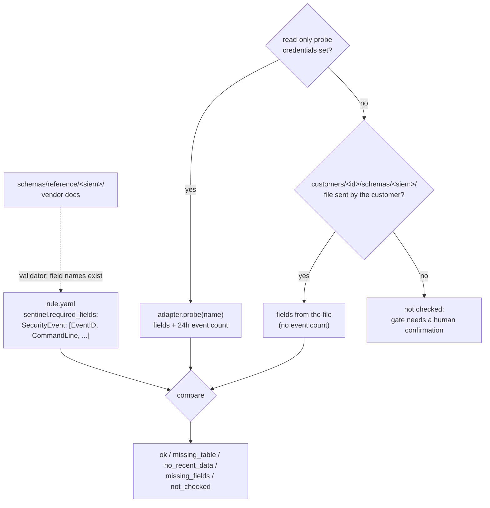

# Schema check

Code: `dac/schema_check.py`, `probe()` in each adapter, `schemas/reference/`.
Decision record: [ADR 005](../decisions/005-schema-check.md).
Run: `python -m dac schema-check --customer <id> --siem <siem>`.

## What it does
For each rule that applies to a customer, it checks whether the data
the rule reads exists in that customer's SIEM: the table / source / log
type is there, events arrived in the last 24 hours, and every field the
query uses is present. It reports exactly what is missing, and the
log-source gate uses the result.

## How it works


**Each SIEM in its own terms.** `required_fields` keys, reference
schemas and probes use that SIEM's vocabulary; nothing is translated
between them.

| | Sentinel | Splunk | Google SecOps |
|---|---|---|---|
| Unit of data | table (`SecurityEvent`, `Syslog`, `CommonSecurityLog`, `SigninLogs`) | index + source / sourcetype (`XmlWinEventLog:Security`) | log type (`WINDOWS_SYSMON`) |
| Field names | table columns | extracted fields (add-on / CIM names) | UDM paths (`target.process.command_line`) |
| Probe | Log Analytics query API: `T \| getschema`, `T \| where TimeGenerated > ago(24h) \| count` | export search: `search index=* (source="X" OR sourcetype="X") \| fieldsummary` over 24h | UDM search: `metadata.log_type = "X"` over 24h, 100-event sample |
| Can tell "missing" from "empty"? | yes (query fails to resolve the table) | no | no |
| Read-only access needed | Entra app with **Log Analytics Reader** on the workspace; `SENTINEL_WORKSPACE_ID` (GUID) | token whose role can search the relevant indexes | viewer role; short-lived token via workload identity |

**Least privilege.** The probe and deploy can use the same Entra app
for Sentinel, but the roles differ: Log Analytics Reader for the probe,
Microsoft Sentinel Contributor for deploy. Give a job only the role it
uses; the probe never needs write access anywhere.

**When the customer's data lands elsewhere** (for example all sources
forwarded into `Syslog`), the probe reports the expected table missing,
and the reminder asks the team where the data lands and for its
schema. The team's answer is committed as
`customers/<id>/schemas/<siem>/<name>.yaml`:

```yaml
name: Syslog
fields: [TimeGenerated, Computer, HostName, SyslogMessage, ProcessName]
provided_by: Acme SOC (A. Person)
provided_on: 2026-10-27
notes: Windows 4688 events forwarded by agent X as raw XML in SyslogMessage.
```

and the rule is adapted by hand (see the `schema-check` skill). The
schema check never rewrites a rule.

## Why this method
A rule deployed against a table that is missing, empty or lacks a field
deploys cleanly and never fires; nothing reports the failure. Asking
the SIEM directly is the only check that sees the data rather than a
person's description of it. Declaring `required_fields` per rule makes
the comparison exact and lets the validator catch field typos against
vendor docs before anything reaches a customer. Keeping each SIEM in
its own vocabulary avoids a translation layer that would itself need
testing against three live products.

## Advantages
- Reminders name the exact gap ("SecurityEvent: missing CommandLine"),
  so the owning team knows what to fix (here, command-line auditing).
- Baseline rules (ADR 004) can reach a new customer with no human step
  when the probe passes.
- A probe can overrule a stale human confirmation.
- Typos in field names fail CI against the reference schemas.

## What it does not do
- Not verified against any live SIEM. Probe requests and response
  shapes come from vendor references; the SecOps one is the least
  certain and is marked as a guess in the code.
- Does not check that field *values* are usable (populated, parsed,
  in the expected format), only that fields exist.
- `required_fields` is hand-written and can drift from the query.
- Reference schemas exist only for SecurityEvent, Syslog and
  CommonSecurityLog. Where no reference exists, field names are not
  validated. Provenance is recorded in each file.
- Does not adapt rules to a different integration; people do.
